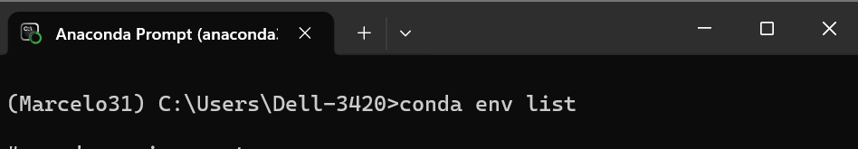
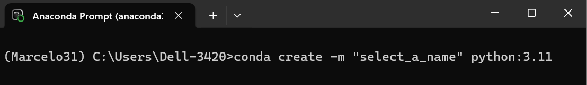
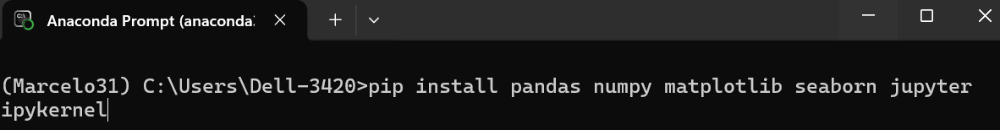
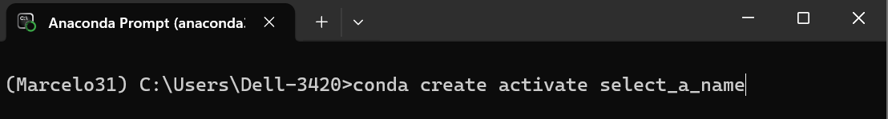
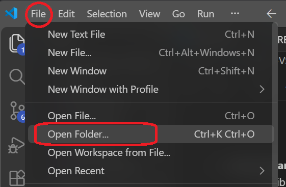
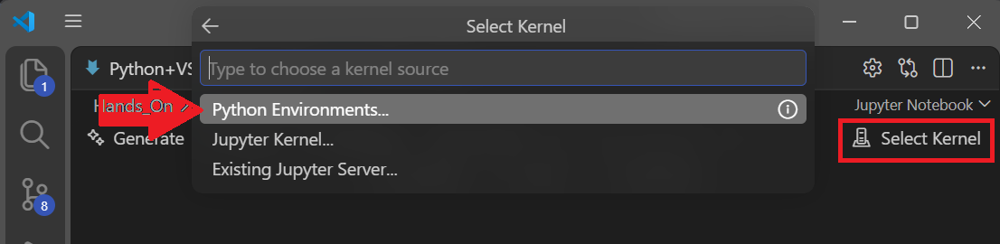
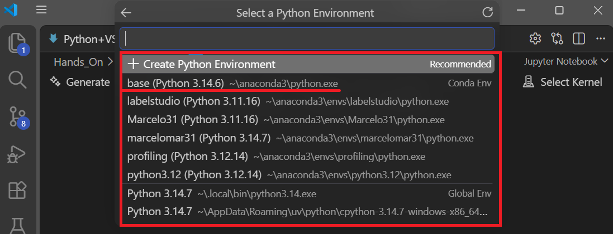

# Setup of Python & VScode

1.  **Initial setup (one time):**
    
    1.  Install Anacoda: https://www.anaconda.com/docs/getting-started/installation
    2.  Install VScode: https://code.visualstudio.com/download
2.  Create a python environment:
    
    1.  Open Anaconda terminal:
        1.  
    2.  Create an environment with this command, select your own name:
        1.  .
    3.  Activate the environment just created, so you can work on it:
        1.  .
3.  **Install libraries**
    
    1.  A library is a packaged collection of pre-written code (functions, classes, modules) that you can use instead of writing everything from scratch. After the installation you need to import them so Python can use them.
    2.  Use **pip install** + the libraries that you need:
        1.  .
4.  **Create a project folder to work on it:**
    
    1.  For example =>DataLabeling.
        
        1.  Open VScode and open the folder just created:
            
5.  **Configure VScode:**
    
    1.  Select the Kernel. This is just the environment created before, is the python engine that will execute code. In the top rigth click in Select Kernel, later in the drop option click in Environments... 
    2.  Now you will have a list of all the environment created, here you need to select the environment previous created and will all the libraires installed. In this case "base" is show as first option:
