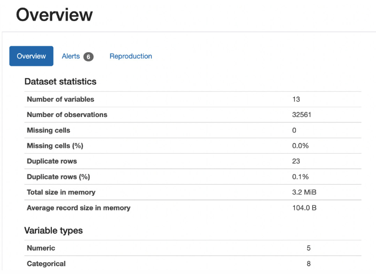
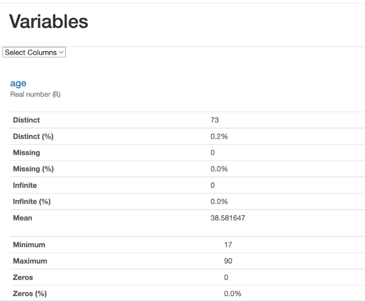
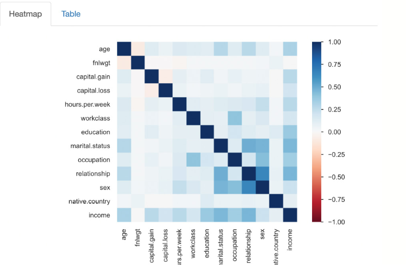

# Typical workflow

### ✅Pandas

First let's realize that Pandas is an open source library used for data analysis and manipulation. It provides various functions for data wrangling, cleaning, and merging operations. Let us see how to explore data using the pandas library. You can explore it and for example find the following insights:

*   Description of the dataset
*   Summary statistics such as mean value and quantile values for each feature
*   How many unique values are there?
*   Duplicate and outiner vales..etc.

### ✅Data Analysis typical workflow

1.  Load the dataset. Is recomendable to have the dataset in the project folder. After that you can use pandas to load the file:
    1.  import pandas as pd//import pandas libray needed to use it functions
    2.  df = pd.read\_csv("data/adult.csv")//use the funtion read to load the file, you have to specify the corret path to the file.
2.  Show an overview of the dataset like: 1-Columns name, 2-Data type, 3-Missing values, 4-Total rows:
    1.  df.info()
3.  Show the dataset size by rows and columns:
    1.  df.shape
4.  Show the 15 column names in the dataset:
    1.  df.columns
5.  Identify the categorical columns and numerical columns in the dataset, this can be coorelated to classes in the dataset:
    1.  catogrical\_column = \[column for column in df.columns if df\[column\].dtypes == 'object'\]
    2.  print(catogrical\_column)
6.  Show statistics:
    1.  df.describe().T
7.  Show the first five rows:
    1.  df.head()
8.  Show the last five rows
    1.  df.tail()
9.  Check for missing values:
    1.  df.isnull().sum()
10.  Check for duplicates:
     1.  df.dupliate().sum()
11.  Examine categories: 1-How many?, 2-Names?
     1.  df.\[categories\].value\_counts()
12.  Outliers = etreme values or potentila data erros:
     1.  sns.boxplot(data=df), plt.show().
13.  Correlation will show relationships between variables:
     1.  sns.heatmap(df.corr(numeric\_only=Ture),
     2.  annot = True)
     3.  plt.show()
14.  Visualize distributions:
     1.  Libraries = seaborn, metplotlibe.pyplot
     2.  Will show: 1-data distribuiotn, 2-strange values
         1.  df.hist(figsize =(12,8)
         2.  plt.show()
15.  Clean data
     1.  Remove duplicates:
         1.  df.drop\_duplicates()
     2.  Fill missing values:
         1.  df.astype()
16.  Save cleaned data
17.  Build the model

### ✅Profiling Data Using the YData-Profiling Library

Let us explore the dataset and generate a profiling report with various statistics using the **ydata-profiling** library that will generate automaticaly an exploration data analysis by profiling and report. This is much convenient that run each command at the time like is detail above. For a large dataset you can have a fast overview of it with this tool.

Statistics show using ydata-profiling library:

1.  Overview:
    1.  Number of variables
    2.  Number of observation
    3.  Duplicate rows
    4.  Missing cells
    5.  
2.  Per-column/variables details. You can select one variable and look for:
    1.  Min/max/average
    2.  Distribution charts
    3.  How many unique values
    4.  Common values
    5.  
3.  Types detected
    1.  Whether a column looks numeric
    2.  Categorical
    3.  Boolean
    4.  Datetime
    5.  Text
4.  Correlations
    1.  Which columns tend to move together (e.g., house size vs. price)
    2.  
5.  Warnings
    1.  Flags for constant columns, high cardinality (too many unique values)
    2.  Imbalanced categories, etc.

### ✅Run ydata-profiling

1.  Instal the library in the environment:
    1.  **pip install ydata-profiling**
2.  Import the library:
    1.  **from ydata\_profiling imoprt ProfileReport**
    2.  **import pandas a pd**
3.  Load the dataset:
    1.  **df=pd.read\_csv("adutl.csv")**
4.  **Run the profiling report:**
    1.  **report = ProfileReport(df, title="Profiling Analysis")**
    2.  **report.to\_file("report.html").** This will open a browser with the report.
