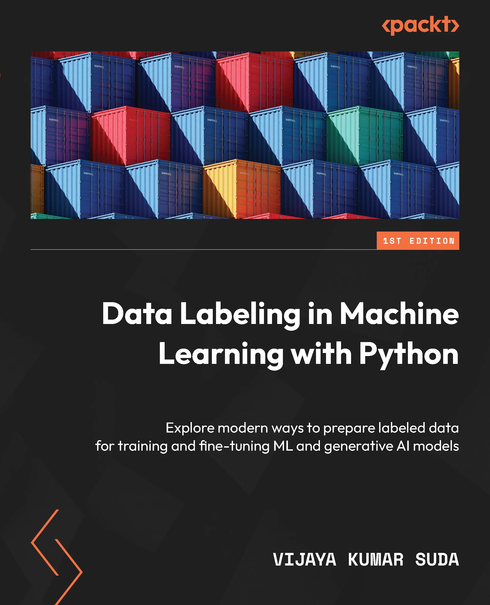

# Data-Labeling-in-Machine-Learning-with-Python

### This repo guides through essential data exploration techniques, including statistical analysis and visualization using Python libraries by packt.

### It covers the importance of data labeling and the role of exploratory data analysis (EDA) in preparing data for machine learning by using Pandas and Seaborn to uncover patterns and insights.

*   **Identify key components of exploratory data analysis and their role in machine learning projects.**
*   **Apply Pandas functions to calculate summary statistics and categorize data types.**
*   **Analyze correlation matrices and visualizations to interpret relationships between variables.**

**\
**
